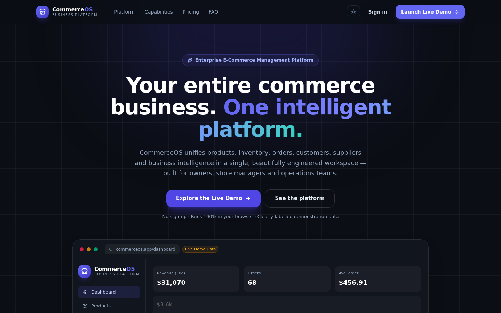
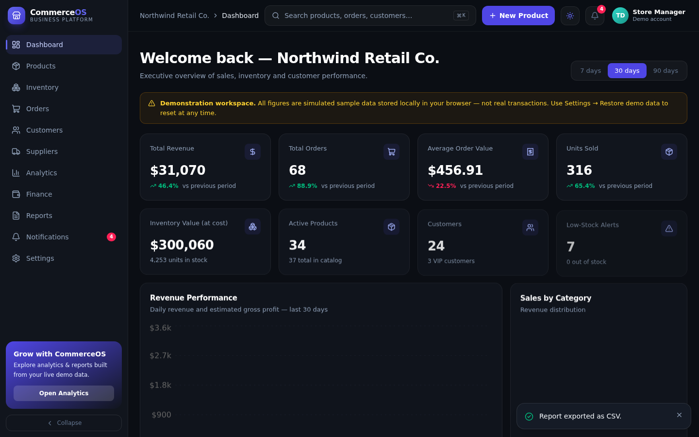
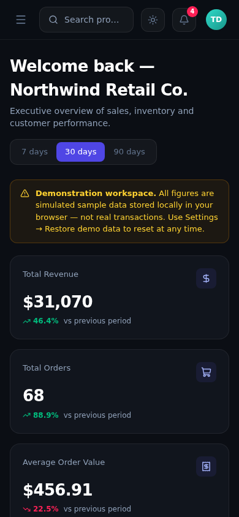

# CommerceOS

**Your Entire Commerce Business. One Intelligent Platform.**

CommerceOS is an enterprise-grade **E-Commerce Management & Business Intelligence Platform** — a complete, interactive SaaS-style application that unifies products, inventory, orders, customers, suppliers, analytics, finance and reporting in a single workspace.

> **Project 02** in the [Talha Dev](https://github.com/talhadev-pk) software engineering portfolio (Project 01: FlowPilot). CommerceOS has a fully independent product identity, design language and feature set.

🔗 **Live demo:** https://talhadev-pk.github.io/commerceos/


---

## 📸 Screenshots

| Marketing Website | Executive Dashboard |
|---|---|
|  |  |

| Mobile Dashboard |
|---|
|  |

---

## ✨ Features

### Public Marketing Website (`/`)
- Premium animated hero with a **live dashboard preview rendered from real app data** (not a screenshot)
- Animated statistics, scroll-triggered reveals, subtle parallax
- Platform capabilities showcase, pricing with monthly/yearly toggle, FAQ accordion, CTA & footer
- Fully responsive, dark/light themes

### Application (`/app`)
| Module | Highlights |
|---|---|
| **Executive Dashboard** | 8 KPI cards with honest period-over-period deltas, revenue + profit charts, category donut, order volume, top products, inventory alerts, recent orders & activity feed, 7/30/90-day periods |
| **Products** | 36 seeded products · search · category/stock/status filters · sorting · pagination · **grid + table views** · bulk select/actions · detail modal · full CRUD with validated forms · CSV export |
| **Inventory** | Stock/reserved/available, health bars, **validated stock adjustments** (never negative), inline reorder-level editing, valuation at cost/retail, movement audit history |
| **Orders** | 150 simulated orders · search by ID/customer · status & date filters · inline status updates across 7 fulfilment states · order detail with timeline & **printable summary** |
| **Customers** | Segments (New/Returning/Loyal/At Risk), lifetime spend computed from order history, profiles with order history & auto-saving notes, full CRUD |
| **Suppliers** | Fictional suppliers with lead times, category mapping and **live stock-value-per-supplier**, full CRUD |
| **Analytics** | Revenue/profit trends, AOV trend, category & channel distribution, product performance table, top customers, period + category scoping, CSV export |
| **Finance** | Transparent P&L — gross sales, discounts, net sales, shipping, COGS, estimated gross profit, refunds — **every line explains its formula** |
| **Reports** | 6 report types (Sales, Products, Inventory, Customers, Orders, Finance) with date-range & category configuration, live preview, **CSV export from actual local data** |
| **Notifications** | Stock/order/system alerts generated from live inventory, unread badges, mark-all-read |
| **Settings** | Store profile, theme, notification preferences, full data export, **one-click demo-data restore** |
| **Global Search** | `Ctrl/⌘ + K` command palette across products, orders & customers, plus quick actions |

### Engineering qualities
- **Mathematically consistent data** — every KPI, chart and report is derived from one shared dataset; edit an order and the whole platform recalculates
- **Browser persistence** — Zustand + localStorage with schema validation and graceful fallback; survives refreshes
- **No dead buttons** — every control performs a real action with toast feedback
- **Accessibility** — semantic HTML, ARIA labels, visible focus rings, keyboard navigation, `prefers-reduced-motion` support
- **Performance** — route-level code splitting (15 lazy routes), transform/opacity-only animations, no external image dependencies (locally generated category-coded product visuals)

---

## 🛠 Technology Stack

| Layer | Technology |
|---|---|
| Framework | React 19 + TypeScript (strict) |
| Build | Vite 8 |
| Styling | Tailwind CSS 4 (class-based dark mode, design tokens) |
| Routing | React Router 7 — `HashRouter` so **every deep link works on GitHub Pages** |
| State | Zustand 5 with `persist` middleware → localStorage |
| Charts | Recharts 3 |
| Motion | Framer Motion (scroll reveals, layout animations, page/modal transitions) |
| Icons | Lucide React |
| QA | Playwright (Python) — 24 automated browser tests |

---

## 🚀 Run Locally

```bash
# 1. Clone
git clone https://github.com/talhadev-pk/commerceos.git
cd commerceos

# 2. Install
npm install

# 3. Develop (http://localhost:5173/commerceos/)
npm run dev

# 4. Production build (type-checks first)
npm run build

# 5. Preview the production build
npm run preview

# 6. Lint
npm run lint
```

Requires Node.js 18+ (developed on Node 20).

### Automated QA (optional)

```bash
pip install playwright && python3 -m playwright install chromium
npm run dev &          # in a second terminal
python3 qa_test.py     # 24 tests: all routes, CRUD flows, search, CSV, themes, persistence, console errors
```

---

## 🌐 Deployment (GitHub Pages)

The repository ships ready to deploy:

- Vite `base` is set to `/commerceos/` in `vite.config.ts`
- `HashRouter` guarantees direct access to every route (no SPA 404s)
- `.github/workflows/deploy.yml` builds and publishes on every push to `main`

**To deploy:** push to `main`, then in GitHub → *Settings → Pages* set **Source: GitHub Actions**. The site publishes to https://talhadev-pk.github.io/commerceos/

---

## 📁 Architecture

```
src/
  components/        AppShell (sidebar, ⌘K search, toasts) · ui kit · Charts
  data/seed.ts       Deterministic seeded demo dataset (seeded PRNG)
  lib/utils.ts       Money/date formatting · metrics engine · CSV export
  pages/
    marketing/       Public website
    app/             Dashboard, Products, ProductForm, Inventory, Orders,
                     OrderDetail, Customers, CustomerDetail, Suppliers,
                     Analytics, Finance, Reports, Notifications, Settings
  store/useStore.ts  Zustand store — all CRUD actions + persistence
  types.ts           Strict domain types
docs/screenshots/    README screenshots (captured by qa_test.py)
qa_test.py           Playwright QA suite
```

**Data consistency model:** orders store immutable price/cost snapshots per line item, so historical reports never change when a product is later edited or deleted. All financial figures are computed in `computeMetrics()` with documented definitions (cancelled orders excluded from sales; returned orders tracked as refunds).

---

## 🎲 Demo Data Explanation

- Generated once by a **deterministic seeded PRNG** (`src/data/seed.ts`) — every fresh visitor sees the identical, coherent dataset: **36 products, 150 orders, 24 customers, 8 suppliers, 36 stock movements**
- All people, companies, emails (`@example.com`) and transactions are **fictional and simulated** — clearly labelled in-app with a "Demonstration workspace" banner
- Your edits persist in **your browser only** (localStorage key `commerceos-store-v1`); nothing is uploaded anywhere
- Reset anytime via **Settings → Restore demonstration data**

## ⚠️ Known Limitations

- Frontend-only demonstration — no real backend, authentication, payment processing or multi-user sync (by design; see demo labelling in-app)
- Data is per-browser; clearing site data resets the workspace
- Currency setting is a display preference — amounts are stored/displayed in USD
- Financial figures are **estimates for portfolio purposes**, not audited accounting data

## 📄 License

MIT — see [LICENSE](LICENSE).
